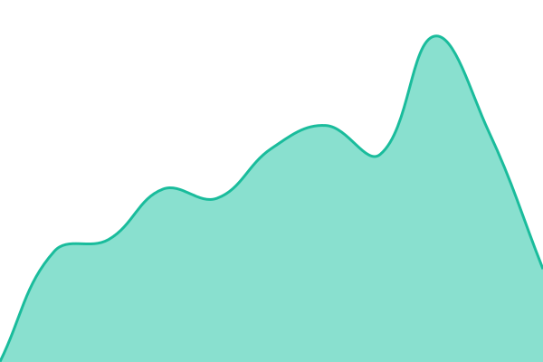

## Engagement Uptimes

<!--start: status pages-->
<!-- This summary is generated by Upptime (https://github.com/upptime/upptime) -->
<!-- Do not edit this manually, your changes will be overwritten -->
<!-- prettier-ignore -->
| URL | Status | History | Response Time | Uptime |
| --- | ------ | ------- | ------------- | ------ |
|  [AreaACrab](https://areaacrab.em.teem.fish) | 🟩 Up | [area-a-crab-engagement.yml](https://github.com/SnapITHD/engagement-uptimes/commits/HEAD/history/area-a-crab-engagement.yml) | 

 581ms
     
 | 

<a href="https://SnapITHD.github.io/engagement-uptimes/history/area-a-crab-engagement">100.00%</a>
    

<!--end: status pages-->

## 📄 License

- Powered by: [Upptime](https://github.com/upptime/upptime)
- Code: [MIT](./LICENSE) © [Anand Chowdhary](https://anandchowdhary.com)
- Data in the `./history` directory: [Open Database License](https://opendatacommons.org/licenses/odbl/1-0/)
